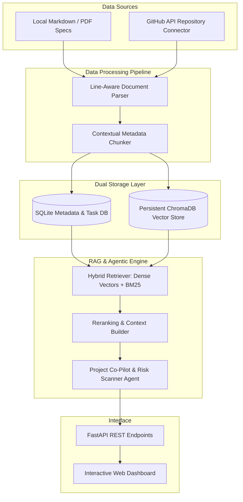

# ⚡ ProjectPulse AI: AI-Native Project Coordination & RAG Workspace

> **The central workspace where large-scale projects live, with AI as the driving force throughout.**

[](https://www.python.org/downloads/)
[](https://fastapi.tiangolo.com/)
[](https://www.trychroma.com/)
[](LICENSE)

---

## 📌 Project Overview

In large-scale technical projects, critical information is scattered across architectural specs, meeting notes, PR descriptions, and task boards. **ProjectPulse AI** is an AI-driven project coordination engine designed to unify project documentation, structure complex data, and act as an intelligent co-pilot for technical teams.

### 🌟 Key Capabilities
- 📄 **Multi-Source Ingestion Pipeline:** Ingests local Markdown files, technical PDFs, and public **GitHub Repositories** via the GitHub REST API.
- 🎯 **Verifiable Lineage & Line Citations:** Preserves exact document section headers and line ranges (e.g. `[01_Architecture.md L12-L24]`) so every AI response is 100% traceable.
- 🔍 **Advanced Hybrid Search:** Combines **Dense Vector Embeddings** (`sentence-transformers/all-MiniLM-L6-v2`) with **Sparse Keyword Matching** (BM25) for high retrieval precision over technical code/API names.
- ⚠️ **Autonomous Risk & Contradiction Detector:** An agentic worker that scans incoming documentation against existing specs to flag conflicting architecture decisions or dependency bottlenecks.
- 💻 **Interactive Split-View Dashboard:** Sleek UI displaying active project documents, interactive citation line highlighter, and instant prompt execution.

---

## 🏗️ System Architecture



---

## 🛠️ Tech Stack

* **Core Backend:** Python 3.11, AsyncIO, FastAPI, Pydantic v2
* **Vector & Relational Storage:** ChromaDB (Vector Store), SQLite / PostgreSQL (Relational Metadata)
* **Embedding & Retrieval:** `sentence-transformers` (`all-MiniLM-L6-v2`), `rank-bm25` (Sparse Retrieval)
* **API Integrations:** GitHub REST API (`PyGithub` / `requests`), PyPDF
* **Frontend:** Vanilla JS / HTML5 / CSS3 (Glassmorphism design system)

---

## 🚀 Quickstart Guide

### 1. Clone the Repository
```bash
git clone https://github.com/your-username/ProjectPulse-AI.git
cd ProjectPulse-AI
```

### 2. Set Up Virtual Environment & Install Dependencies
```bash
python -m venv .venv
# On Windows:
.venv\Scripts\activate
# On macOS/Linux:
source .venv/bin/activate

pip install -r requirements.txt
```

### 3. Launch the Server & Interactive Dashboard
```bash
python main.py --server
```

Open your browser to **`http://127.0.0.1:8000`** to access the dashboard!

---

## 📂 Project Structure

```
ProjectPulse-AI/
├── data/sample_project/            # Benchmark technical project documentation
├── src/
│   ├── config.py                    # Environment & configuration settings
│   ├── db/                          # SQLite metadata & ChromaDB vector store
│   ├── ingestion/                   # Markdown, PDF & GitHub API parsers
│   ├── rag/                         # Hybrid retriever & AI Risk Detector agent
│   └── api/                         # FastAPI server endpoints
├── web/                             # Split-view web dashboard UI
├── requirements.txt                 # Dependencies
└── main.py                          # Application entrypoint & CLI runner
```

---

## 📜 License
Distributed under the MIT License. Built for DTU Software Engineering portfolio showcase.
